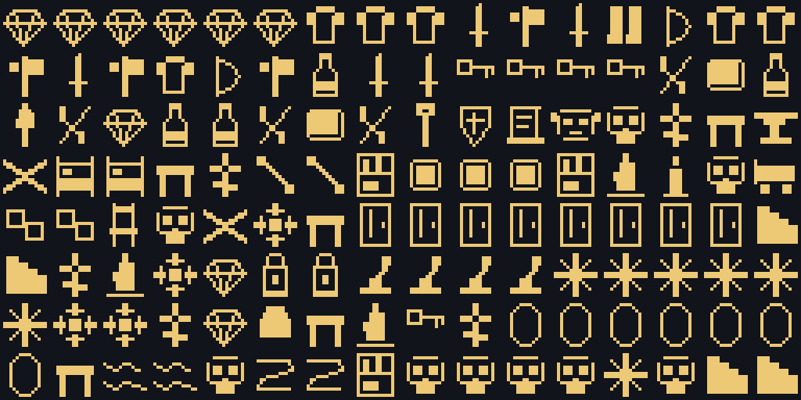
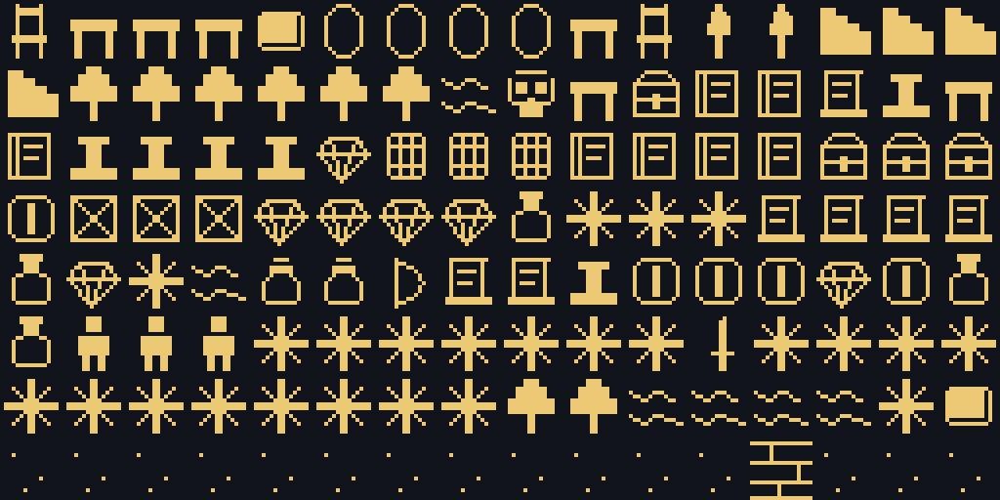
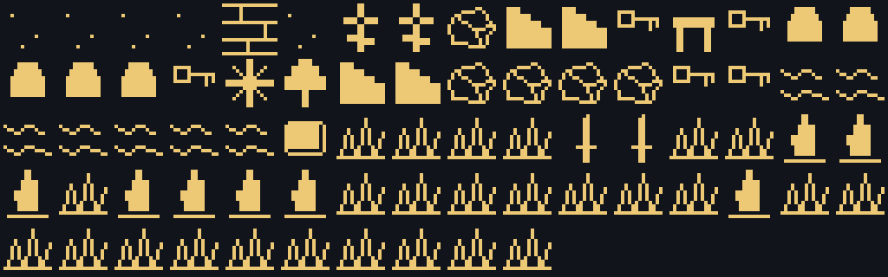

# Ревизия графических назначений

Проверены все четыре поставляемых пакета: `base`, `demo`, `dev`, `maps`.
**598 визуальных определений, 623 назначения** с учётом вариантов и состояний
дверей. Отсутствующих и непроверенных назначений в поставляемом контенте — **0**.

В библиотеке **1782 записи**: все **1078** клеток Kenney 1-Bit Pack 1.2
с координатами, CC0 и путём к оригинальной лицензии; используемые текстовые
знаки встроенного шрифта; рисунки предметов и состояний окружения.
Неразобранные клетки атласа остаются в библиотеке и не назначены контенту.

## Исправления

- Лампы и факелы больше не используют похожие на ключи клетки прежнего атласа.
- Кровати и стулья получили отдельные силуэты вместо вывесок и книжных полок.
- Сундуки, ящики, бочки, мешки, урны и сосуды имеют соответствующие рисунки.
- Для оружия, доспехов, книг, свитков, инструментов, еды и материалов
  добавлены одноцветные изображения; общий рисунок используется для одного типа.
- Двери разделяют рисунок определения и состояния: закрыта, заперта, открыта;
  погнутые прутья и каменная плита имеют отдельные маски.
- Поверхности, текстуры и направленные знаки, для которых текстовый рисунок
  уже подходил, перенесены из встроенного шрифта. Импорт всего Unicode не выполнялся.
- Перенесены варианты внешности, клетки артов и переопределения экземпляров.
  Маркер неизвестного объекта намеренно сохраняет знак `?`.

## Проверка переноса

Перед изменениями сохранена полная копия пакетов:
`backups/symbols_20261012_104411_449278/`. Перед уточнением назначений создана
дополнительная копия `backups/symbols_20261012_104822_981619/`.
Резервные копии локальные, исключены из Git; готовые `packs/` входят в проект.

Сравнение всех исходных и перенесённых документов после исключения графических
полей подтвердило неизменность механик, координат, размещений и масок.
Проверены ссылки и зависимости пакетов. Повторный запуск миграции: **0 изменений**.
Старые документы продолжают читаться через совместимость `glyph`/`char`.

## Полный перечень и предпросмотр

[Все назначения, варианты и состояния](inventory.json) — сводный машинный список.
[Журнал уточнений](assignments.json) фиксирует уточнения миграции;
полным перечнем является `inventory.json`.
[Порядок символов на листах](sheets.json): 16 столбцов, до 128 клеток на листе,
строки слева направо. Листы показывают согласованные предметные рисунки;
текстовые знаки и неразобранный атлас доступны в библиотеке студии.

[Инструкция по рисованию и назначению](../symbols.md).
